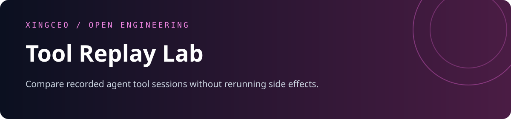
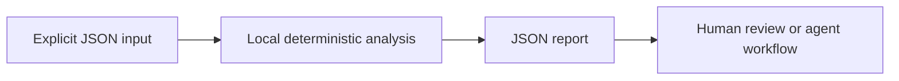

<div align="center">



[](https://github.com/XingCEO/tool-replay-lab/actions/workflows/ci.yml)

[](LICENSE)


**Compare recorded agent tool sessions without rerunning side effects.**

[Try it](#quickstart) · [Input contract](#input-contract) · [Example report](examples/output.json) · [Contribute](CONTRIBUTING.md)

</div>

## The problem

Replaying a payment, deployment or file-write tool against a live service is often the wrong way to investigate a regression. Recorded sessions can provide an offline behavioral contract.

## How it works

Compare expected and observed call sequences, including arguments, results and error payloads. Explicit JSON Pointer ignore rules remove volatile fields from deep copies. Sequence alignment identifies insertions and deletions without causing every following call to look changed.



## Quickstart

Requires Python 3.11 or later. The analyzer has **no runtime dependencies**, makes no network requests and runs no shell commands. Domain-specific interpretation (such as SQL rehearsal) is described below.

```bash
git clone https://github.com/XingCEO/tool-replay-lab.git
cd tool-replay-lab
python3 -m tool_replay_lab examples/input.json
```

Optional installation into an isolated environment:

```bash
python3 -m venv .venv
. .venv/bin/activate
python -m pip install .
tool-replay-lab examples/input.json
```

The package is installed from this checkout; no PyPI publication is claimed.

## Input contract

Use [the complete example](examples/input.json) as a starting point. Paths and strings in JSON are data unless the contract explicitly says they refer to local files.

| Field | Meaning |
| --- | --- |
| `expected / observed` | Arrays of tool calls. Each call needs tool; arguments, result and error are compared as JSON. |
| `ignore` | Optional JSON Pointers relative to each call; explicit paths only, no wildcard syntax. |

## Example result

Generated by running the committed example:

```json
{
  "changes": [
    {
      "expected": {
        "arguments": {
          "q": "cache"
        },
        "result": {
          "count": 2
        },
        "tool": "search"
      },
      "expected_index": 0,
      "kind": "response_changed",
      "observed": {
        "arguments": {
          "q": "cache"
        },
        "result": {
          "count": 3
        },
        "tool": "search"
      },
      "observed_index": 0
    }
  ],
  "ignored_pointers": [
    "/result/request_id"
  ],
  "matches": false
}
```

## Use from another tool

```python
import json
from tool_replay_lab import analyze

with open("examples/input.json", encoding="utf-8") as stream:
    report = analyze(json.load(stream))
```

`analyze(data)` returns a JSON-serializable dictionary. The CLI accepts `-` for stdin, writes reports to stdout and input errors to stderr. Exit `0` means analysis completed, including reports containing findings; exit `2` means invalid input or an unreadable file. Gate CI on the report's documented fields, rather than assuming exit `0` means no findings. The JSON report is a v0.1 interface and may evolve before 1.0.

## Validation

```bash
python3 -m unittest discover -v
```

Tests cover the example, malformed CLI input, and the domain-specific boundary cases in [tests/test_core.py](tests/test_core.py). CI also installs the package and runs its console entry point on Python 3.11 and 3.13. Test success demonstrates these cases; it is not evidence of production deployment.

## Scope and limits

This is a trace comparator, not a mock server or a tool executor. Order matters. Matching uses tool name plus normalized arguments; repeated identical calls can have ambiguous alignment. Ignoring a field can hide regressions, so every rule is included in the report.

This is a focused experimental first release. Review findings before changing production systems. Inputs and reports may contain your own source or metadata; keep them in an appropriate local workspace.

## Related work and references

- [JSON Pointer RFC 6901](https://www.rfc-editor.org/rfc/rfc6901)
- [VCR.py](https://github.com/kevin1024/vcrpy)

These projects and specifications inform the problem space. This repository is an independent implementation; it does not claim to replace the referenced systems or to have invented the underlying techniques.

## Contributing

A small real-world fixture with expected behavior is the most useful contribution. See [CONTRIBUTING.md](CONTRIBUTING.md). Please remove private data before filing an issue.

## License

[MIT](LICENSE) © 2026 XingCEO.
